# Galaxia Fennec — Proyecto final de Gráficas por Computadora

Un pequeño sistema solar que se explora manejando el **Fennec de Rocket League** como nave
espacial. Todo se dibuja con un **renderizador por software propio** escrito en C++: SDL2 solo
abre la ventana, lee el teclado y muestra el framebuffer que calcula el programa.

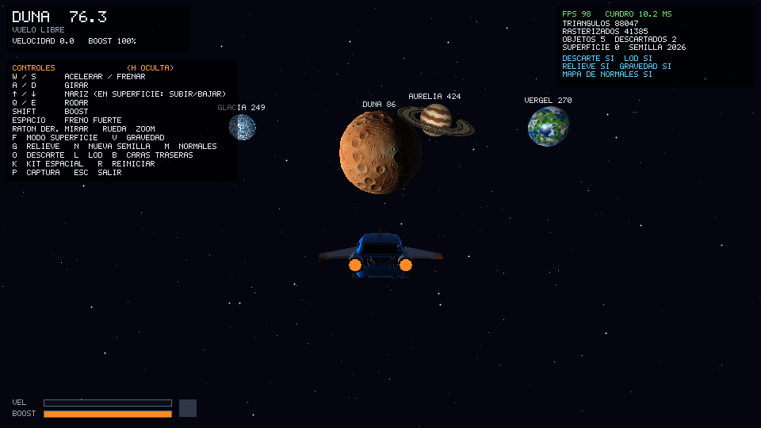

El sistema tiene un sol animado y cinco planetas con identidad propia que orbitan y giran según el
tiempo transcurrido:

| Planeta | Superficie | Objetos encima |
|---|---|---|
| **Duna** | Desierto craterizado, con dunas en las tierras bajas y **geometría deformada con ruido** | Rocas y balizas con luz |
| **Glacia** | Placas de hielo con grietas que brillan de noche | Cristales que brotan en las grietas |
| **Vergel** | Continentes, océanos, montañas nevadas y **nubes animadas** | Bosques de árboles alienígenas y rocas |
| **Aurelia** | Gigante gaseoso con bandas que giran a distinta velocidad, una gran tormenta y **anillos** | — (es de gas) |
| **Ignis** | Planeta volcánico junto al sol, con ríos y lagos de **lava que brilla** | Rocas sobre el basalto |

Las órbitas siguen la **tercera ley de Kepler** (el periodo crece con el radio a la 1.5): Ignis, el
más cercano al sol, da una vuelta en ~35 s y Aurelia, el más lejano, en ~430 s. Entre Glacia y
Vergel hay un **cinturón de asteroides**: el carro puede chocar las rocas, que salen disparadas y,
si llegan a un planeta o al sol, **explotan**.

El carro puede viajar entre ellos, acercarse, rodearlos en **modo superficie** y volver a alejarse
sin pantallas de carga ni cambios de escena.

| | |
|---|---|
| 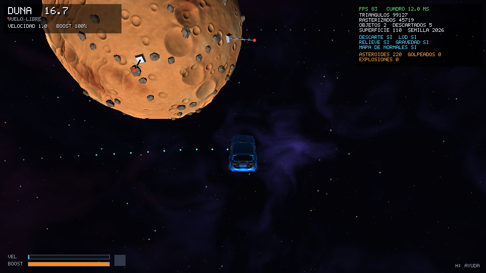 | 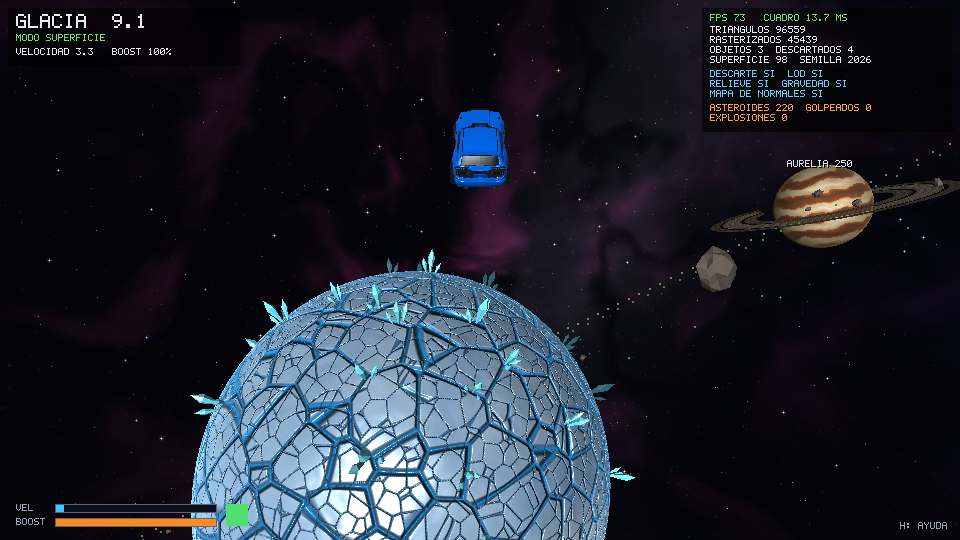 |
| 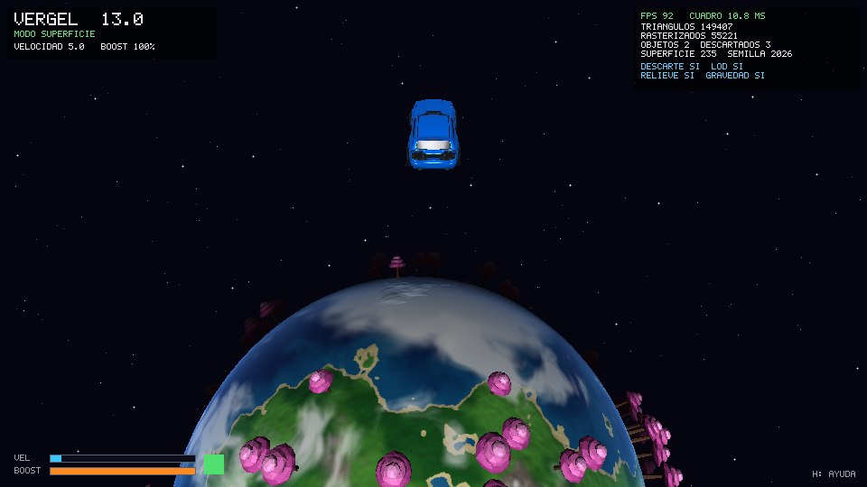 | 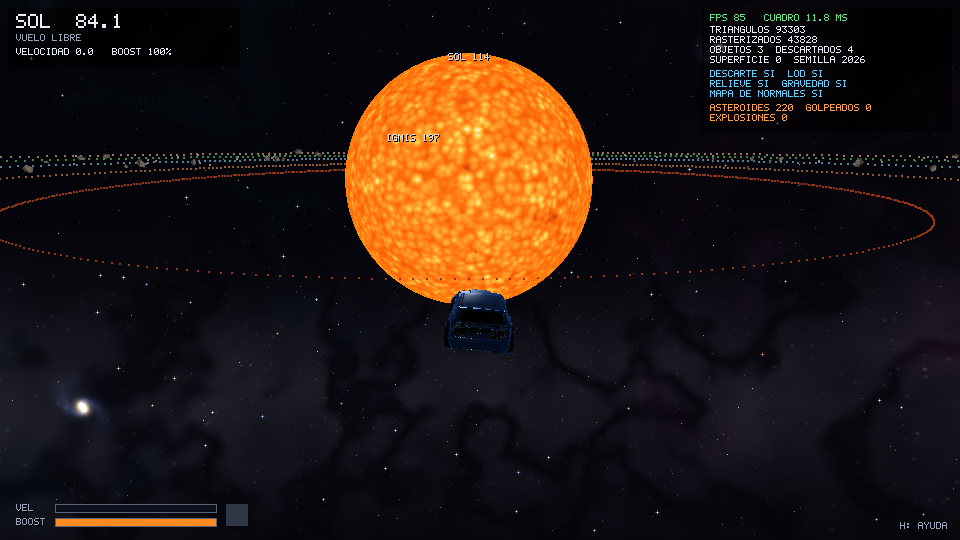 |
| 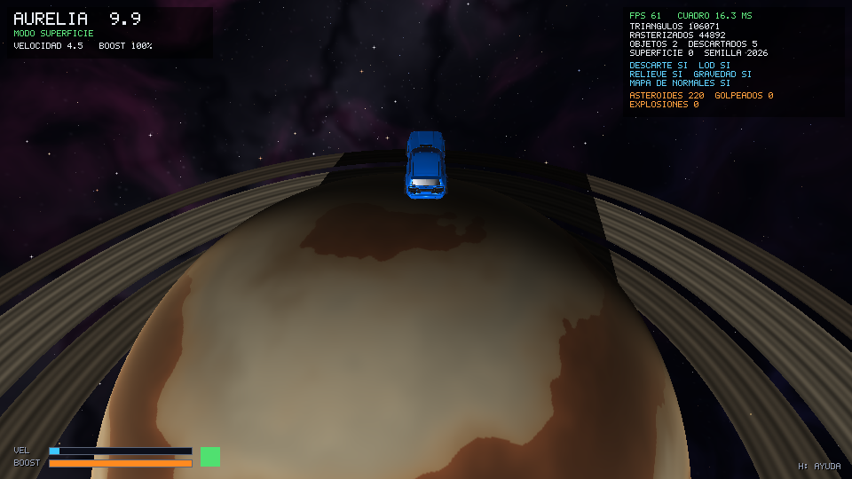 | 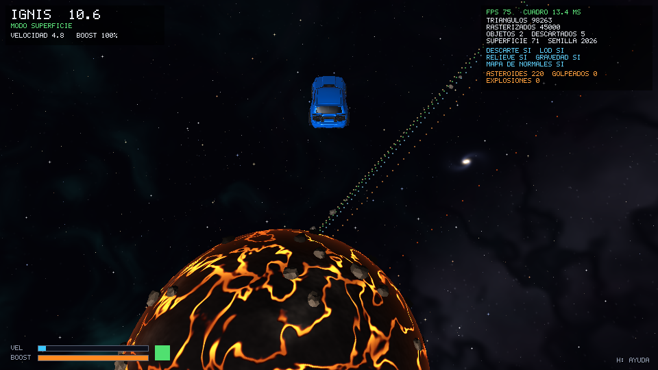 |
| 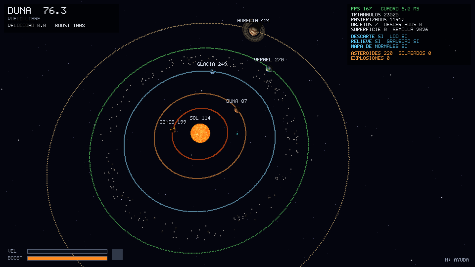 | 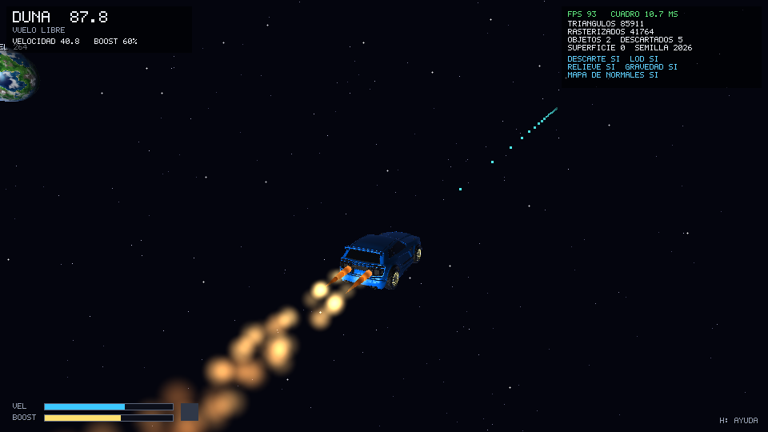 |
| 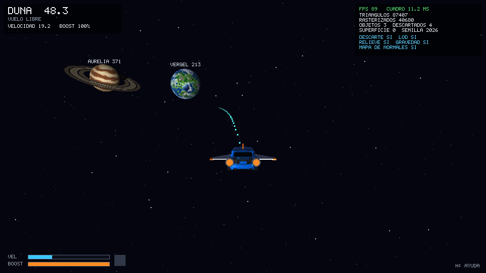 | 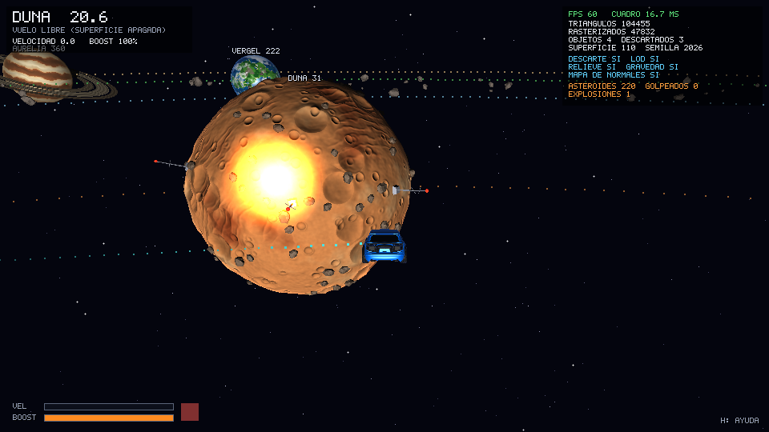 |

---

## Integrantes y contribuciones

> **Completar antes de entregar.**

| Integrante | Carné | Contribuciones |
|---|---|---|
| _[nombre]_ | _[carné]_ | _[partes que implementó y puede explicar]_ |

## Recursos externos y uso de IA

- **Modelo del carro:** el Fennec es un modelo del videojuego *Rocket League* (Psyonix). Se obtuvo
  como recurso externo (carpeta [fennec-rocket-league-car/](fennec-rocket-league-car/): FBX y texturas);
  **no fue modelado por el equipo**. La llama del boost sale de los dos escapes que ya tiene el
  modelo, como en el juego; su posición se encontró analizando la geometría de la parte trasera
  ([src/boost_flame.h](src/boost_flame.h)). Se convirtió a OBJ con un script propio de Blender
  ([tools/export_car.py](tools/export_car.py)), que corrige los ejes, las ruedas espejadas, exporta
  las coordenadas de textura y los mapas de normales del modelo (reducidos a 1024 px en
  `assets/textures/`) y genera una versión reducida (LOD).
- **Modelos de superficie** (roca, árbol, cristal, baliza): construidos en código por el equipo
  ([src/props.cpp](src/props.cpp)).
- **Texturas de los planetas y del sol:** generadas por procedimiento con ruido propio al arrancar.
  No se usan imágenes externas.
- **Base de código:** el framebuffer, la exportación a PNG y la idea del rasterizado por funciones
  de arista vienen del laboratorio 4 del curso.
- **Asistencia de IA:** se usó Claude Code (Anthropic) como asistente de programación durante el
  desarrollo, trabajando por fases e incrementos revisados y confirmados por el equipo. El equipo es
  responsable del código entregado y debe poder explicarlo.

## Tecnologías

- **C++17**, compilado con GCC (MSYS2 UCRT64) en modo Release.
- **SDL2**: solo para la ventana, la entrada de teclado y ratón, y copiar el framebuffer a la
  pantalla. No se usan sus funciones de dibujo.
- **CMake + Ninja** para compilar.
- **zlib**, solo para descomprimir los datos de los PNG de los mapas de normales del carro. El resto
  del lector de PNG (bloques del archivo y filtros de cada fila) es propio ([src/texture.cpp](src/texture.cpp)).
- **Blender 5.2**, solo para convertir el modelo del carro (no se necesita para compilar ni ejecutar).
- No se usa ningún motor de juego, motor de física, OpenGL, shaders de GPU ni otra biblioteca de
  gráficos. Los hilos (`std::thread`) son de la biblioteca estándar de C++.

---

## Compilar y ejecutar

Probado en **Windows 11** con **MSYS2 UCRT64**.

1. Instalar las herramientas en la terminal de MSYS2 UCRT64:
   ```sh
   pacman -S mingw-w64-ucrt-x86_64-gcc mingw-w64-ucrt-x86_64-cmake \
             mingw-w64-ucrt-x86_64-ninja mingw-w64-ucrt-x86_64-SDL2 \
             mingw-w64-ucrt-x86_64-zlib
   ```
2. Compilar desde la raíz del repositorio:
   ```sh
   cmake -S . -B build -G Ninja
   cmake --build build
   ```
   Al compilar se copian `assets/` y `SDL2.dll` dentro de `build/`. Las bibliotecas de C++ y zlib
   quedan enlazadas dentro del ejecutable.
3. Ejecutar desde la carpeta `build`:
   ```sh
   cd build
   ./galaxia.exe
   ```
   También se puede abrir `build/galaxia.exe` con doble clic o desde PowerShell, sin tener MSYS2 en
   el PATH.

Al arrancar tarda unos **3 segundos** en generar las superficies del sol y los planetas.

### Opciones de línea de comandos (para pruebas)

| Opción | Qué hace |
|---|---|
| `--seed N` | Semilla para repartir los objetos de superficie (por defecto 2026) |
| `--near N` | Empieza frente al lado de día del cuerpo N (1 = Duna, 2 = Glacia, 3 = Vergel, 4 = Aurelia, 5 = Ignis) |
| `--hide-help` | Empieza sin el panel de controles |
| `--flat` | Duna sin deformar (esfera), para comparar |
| `--test-impact` | Lanza un asteroide hacia Duna (para ver la explosión) |
| `--test-hit` | Pone un asteroide quieto delante del carro (para chocarlo) |
| `--no-opt` | Sin descarte de objetos ni LOD, para comparar contadores |
| `--no-normal-map` | El carro sin mapas de normales, para comparar |
| `--time S` | Adelanta la simulación S segundos |
| `--dt-test` | Prueba de consistencia: el mismo vuelo simulado a 20, 30, 60, 144 y 240 FPS |
| `--screenshot archivo.png` | Guarda un cuadro y termina (se combina con las opciones siguientes) |
| `--fly "w:3,wa:2"` | Antes de la captura, simula un vuelo: teclas `w s a d q e`, `i`/`k` = flechas, `b` boost, `x` freno |
| `--look yaw pitch` | Gira la cámara alrededor del carro (grados) en la captura |
| `--zoom D` | Distancia de la cámara al carro en la captura |

---

## Controles

| Tecla | Acción |
|---|---|
| `W` / `S` | Acelerar / frenar (con el carro detenido, `S` da reversa) |
| `A` / `D` | Girar a la izquierda / derecha |
| `↑` / `↓` | En vuelo libre: subir o bajar la nariz. En modo superficie: subir o bajar de altitud |
| `Q` / `E` | Rodar sobre el eje del carro (como el air roll de Rocket League) |
| `Shift` | Boost: sale fuego de cohete de los escapes del carro y deja una estela; dura 3 s y se recarga solo |
| `Espacio` | Freno fuerte que también detiene los giros y la deriva por gravedad |
| Botón derecho + ratón | Mirar alrededor del carro. Al soltar, la cámara vuelve atrás |
| Rueda del ratón | Acercar o alejar la cámara del carro |
| `F` | Activar o desactivar el modo superficie |
| `V` | Activar o desactivar la gravedad |
| `T` | Mostrar u ocultar las líneas de las órbitas de los planetas |
| `Y` | Mostrar u ocultar los puntos de la trayectoria prevista del carro |
| `G` | Duna deformada o como esfera lisa |
| `M` | Activar o desactivar los mapas de normales del carro |
| `N` | Nueva semilla para los objetos de superficie |
| `O` | Activar o desactivar el descarte de objetos |
| `L` | Activar o desactivar el nivel de detalle automático |
| `B` | Activar o desactivar el descarte de caras traseras |
| `H` | Mostrar u ocultar la ayuda de controles |
| `R` | Volver al punto de inicio |
| `P` | Guardar una captura en `captura.png` |
| `Esc` | Salir |

### La cámara

- **En vuelo libre** funciona como la cámara de carro de *Rocket League*: sigue al carro pero no su
  orientación. Se queda nivelada con el horizonte (no rueda) y se coloca detrás del **rumbo
  horizontal** del carro, así el carro puede inclinarse, rodar o dar volteretas delante de la cámara
  sin que la pantalla gire ([camera.cpp](src/camera.cpp)).
- **En modo superficie** se alinea con el carro y la vertical del planeta, sube y mira por debajo
  del carro para que se vea la superficie. Entre los dos modos la transición es suave.

### Cómo leer el HUD

- **Arriba a la izquierda:** cuerpo más cercano y altitud, modo (vuelo libre o **modo superficie**
  en verde), velocidad y boost.
- **Arriba a la derecha:** FPS y tiempo de render del cuadro, triángulos enviados y rasterizados,
  objetos dibujados y descartados, objetos de superficie y semilla, y el estado de cada opción.
- **Sobre cada planeta:** nombre y distancia.
- **Puntos cian delante del carro:** trayectoria prevista para los próximos 3 s. Se curva por la gravedad.
- **Abajo a la izquierda:** barras de velocidad y boost. El cuadro verde indica modo superficie.

---

## Recorrido de demostración (guion para el video)

Duración sugerida: unos 2 minutos. Todo ocurre en la misma escena.

| Tiempo | Qué hacer | Qué se muestra |
|---|---|---|
| 0:00–0:15 | Arrancar el programa y leer la ayuda (`H` la oculta) | Sistema solar: sol, Glacia, Duna y Vergel con sus etiquetas |
| 0:15–0:35 | `W`, girar con `A`/`D`, subir y bajar con `↑`/`↓`, usar `Shift` | Vuelo espacial, aceleración progresiva y boost |
| 0:35–0:45 | Pasar cerca de Duna sin acelerar; pulsar `V` dos veces | La trayectoria prevista se curva por la gravedad |
| 0:45–1:10 | Acercarse a Duna con `W` hasta que se encienda el cuadro verde | Acercamiento, modo superficie, cráteres, rocas y balizas |
| 1:10–1:25 | Mantener `W` y girar un poco con `A`/`D` | **Vuelta completa alrededor de Duna** (~8 s por vuelta) |
| 1:25–1:35 | Pulsar `G` dos veces y `N` una vez | Deformación de la geometría y cambio de semilla |
| 1:35–1:50 | Mantener `↑` hasta salir del modo superficie y luego `Shift` | **Alejamiento**: el planeta vuelve a verse como un cuerpo del sistema |
| 1:50–2:00 | Pulsar `O` y `L` mirando los contadores | El descarte de objetos y el LOD cambian el trabajo del renderizador |

Opcional: pasar por el cinturón de asteroides (entre Glacia y Vergel) y chocar rocas con boost
hacia un planeta para ver la explosión. Visitar los demás planetas. En Glacia las grietas brillan más en el lado de noche, en
Vergel se mueven las nubes, en Aurelia las bandas se deslizan entre sí y la sombra del planeta cruza
los anillos, y en Ignis la lava late con pulsos de calor.

---

## Estructura del proyecto

```
assets/models/        Fennec convertido a OBJ (completo y reducido) + materiales
assets/textures/      Mapas de normales del Fennec (reducidos a 1024 px)
docs/capturas/        Imágenes del README
fennec-rocket-league-car/  Modelo original (FBX y texturas), recurso externo
tools/export_car.py   Conversión del FBX a OBJ con Blender
src/
  main.cpp            Ventana, ciclo principal, entrada, HUD y modo de pruebas
  math3d.h            Vec3, Vec4, Mat4, matrices de modelo, vista (lookAt) y proyección
  framebuffer.*       Pixeles ARGB + buffer de profundidad (base del laboratorio 4)
  renderer.*          Pipeline: vértices, recorte, proyección, raster, profundidad, descarte
  parallel.*          Pool de hilos para rasterizar por franjas
  shaders.*           Shaders de fragmentos (sol, planetas, carro, objetos)
  obj_loader.*        Cargador OBJ/MTL propio (UV, normales, tangentes, mapas de normales)
  texture.*           Lector de PNG y mapas de normales en espacio tangente
  mesh.*, geometry.*  Mallas, icosfera por subdivisión, deformación de esferas y anillos
  noise.*             Ruido Perlin, fbm y celular (Worley)
  cubemap.h           Texturas en cubo (horneado en paralelo y lectura bilineal)
  planets.*           Superficies generadas del sol y de los cinco planetas
  props.*             Modelos de superficie y su distribución con ruido
  scene.*             Sol, planetas (órbitas, giro, LOD), estrellas y objetos de superficie
  ship.*              Física del carro: control, modo superficie, gravedad, colisión
  camera.*            Cámara de persecución
  hud.*, font.*       HUD y fuente propia de 5x7 píxeles
  boost_flame.*       Llama de cohete del boost (escapes del Fennec)
  particles.*         Partículas de fuego y humo (estela del boost y explosiones)
  asteroids.*         Cinturón de asteroides: órbitas, choques con el carro y explosiones
  mesh_builder.h      Ayudante para construir modelos en código con caras planas
```

---

## Cómo funciona el renderizador

### Transformaciones y proyección ([math3d.h](src/math3d.h), [renderer.cpp](src/renderer.cpp))

1. **Etapa de vértices.** Cada vértice se multiplica por `MVP = P · V · M`.
   - **M (modelo):** coloca cada objeto. Por ejemplo, un planeta usa
     `T(órbita) · Rz(inclinación) · Ry(giro) · S(radio)`, y el carro usa sus ejes adelante, arriba y derecha.
   - **V (vista):** sale de `lookAt` con la cámara de persecución.
   - **P (proyección):** perspectiva con campo de visión de 60°, `near = 0.05` y `far = 5000`.
2. **Descarte y recorte.** Se descartan los triángulos que quedan por completo fuera del volumen de
   visión. Los que cruzan el **plano cercano** se recortan con Sutherland–Hodgman (pueden quedar como
   triángulo o como cuadrilátero), para que nunca se divida entre `w ≤ 0` aunque la cámara quede
   pegada a un planeta.
3. **División de perspectiva y viewport.** `x/w`, `y/w` pasan a píxeles; la y se invierte.
4. **Descarte de caras traseras** según el signo del área en pantalla.

### Rasterizado y prueba de profundidad

- Cada triángulo se rellena con **funciones de arista** (la idea del laboratorio 4, en punto
  flotante). Normalizadas por el área dan las **coordenadas baricéntricas** de cada píxel.
- **Prueba de profundidad:** el buffer guarda `1/w` por píxel (más grande = más cerca). Se limpia
  en cada cuadro y un píxel solo se pinta si está más cerca que lo que ya hay. `1/w` es lineal en
  pantalla y conserva buena precisión entre 0.05 y 5000.
- **Interpolación con corrección de perspectiva:** la posición en el mundo, la posición en el modelo
  y la normal se interpolan divididas entre `w`, y luego se dividen entre `1/w` interpolado.
- **Paralelismo:** primero se preparan todos los triángulos en paralelo y luego cada franja
  horizontal de 16 filas se rasteriza en un hilo distinto. Dos hilos nunca escriben el mismo píxel,
  y la imagen es idéntica byte por byte a la versión de un solo hilo.

### Shaders de fragmentos ([shaders.cpp](src/shaders.cpp))

Cada shader es una función que recibe el fragmento interpolado y devuelve su color.

| Shader | Efecto | Técnica |
|---|---|---|
| `sunShader` (**animado**) | Plasma que hierve | Gránulos de ruido celular; cada zona late con un seno desfasado según el tiempo (`u.time`); manchas solares, oscurecimiento del borde y paleta de rojo a blanco |
| `duneShader` | Desierto con relieve | Color y normal leídos de un cubemap que gira con el planeta; línea día/noche suave, luz de relleno nocturna y bruma de atmósfera |
| `glaciaShader` | Hielo | Especular muy concentrado (Blinn-Phong), borde Fresnel azulado y grietas emisivas que brillan más de noche |
| `vergelShader` | Planeta vivo | El sol solo se refleja en el agua (máscara), nubes que se desplazan con una rotación que cambia con el tiempo y atmósfera azul |
| `aureliaShader` | Gigante gaseoso | **Rotación diferencial**: la textura se lee girada según la latitud y el tiempo, así las bandas se deslizan; borde oscurecido y bruma |
| `ringShader` | Anillos | Vetas finas según la distancia al centro, luz por las dos caras y **sombra del planeta** (rayo hacia el sol contra su esfera) |
| `ignisShader` | Volcánico | Roca con relieve y lava emisiva con pulsos de calor que avanzan con el tiempo |
| `carShader` | Carro | Blinn-Phong con los materiales del modelo, **mapeo de normales en espacio tangente** (chasis, rines y llantas), borde Fresnel y faros emisivos |
| `asteroidShader` | Asteroides | Lambert con luz del sol, luz ambiente y un borde tenue para distinguirlos del fondo |
| `flameShader` | Llama del boost | Emisiva. **Núcleo caliente** donde se mira a través de más fuego (centro de la silueta o a lo largo del eje), naranja en los bordes y rojo en la punta; pulsos que viajan hacia atrás con el tiempo |
| `propShader` | Objetos de superficie | Lambert y especular por material, brillo propio y sombra del planeta (sin luz si el sol está bajo su horizonte) |

### Cinturón de asteroides ([asteroids.cpp](src/asteroids.cpp))

- **220 rocas** repartidas con una semilla fija entre los radios 262 y 302, cada una con su órbita
  (Kepler, igual que los planetas), una altura sobre el plano y un giro propio alrededor de un eje
  al azar (matriz de rotación de Rodrigues).
- **Choque con el carro:** esfera contra esfera. La roca sale con la velocidad con que el carro se
  le acercaba (multiplicada, porque es más liviana) y el carro pierde parte de la suya.
- **Vuelo libre:** la roca golpeada siente la misma gravedad que el carro. Si choca con un planeta o
  con el sol, explota: un fogonazo y una ráfaga de partículas de fuego y humo en el punto de impacto,
  que se mueven junto con el planeta. A los 8 s la roca reaparece en el cinturón.
- **Dibujo eficiente:** las rocas visibles se juntan en una sola malla por cuadro; las que no se ven
  se descartan y las muy lejanas se dibujan como un punto.

### Boost: llama de cohete y estela ([boost_flame.cpp](src/boost_flame.cpp))

- **Llama:** un penacho generado por revolución (se ensancha al salir del escape y se afila) en
  cada uno de los dos escapes del Fennec, con `flameShader`.
- **Estela:** mientras hay boost, cada escape suelta 400 partículas por segundo que quedan en el
  mundo y viven ~0.6 s. Nacen blancas amarillas, pasan a naranja y rojo y terminan como humo gris
  mientras crecen. Para que la estela salga continua aunque el carro vaya rápido, cada partícula
  nace en el punto del camino del escape que corresponde a su instante dentro del cuadro.
- **Dibujo:** cada partícula es un disco proyectado con `P · V` que pasa por la prueba de
  profundidad (sin escribirla) y se **suma** al color del píxel (mezcla aditiva). Así se ve
  translúcida sin necesitar transparencia en el pipeline y el orden de dibujo no importa.

### Mapeo de normales del carro ([texture.cpp](src/texture.cpp), [obj_loader.cpp](src/obj_loader.cpp), [shaders.cpp](src/shaders.cpp))

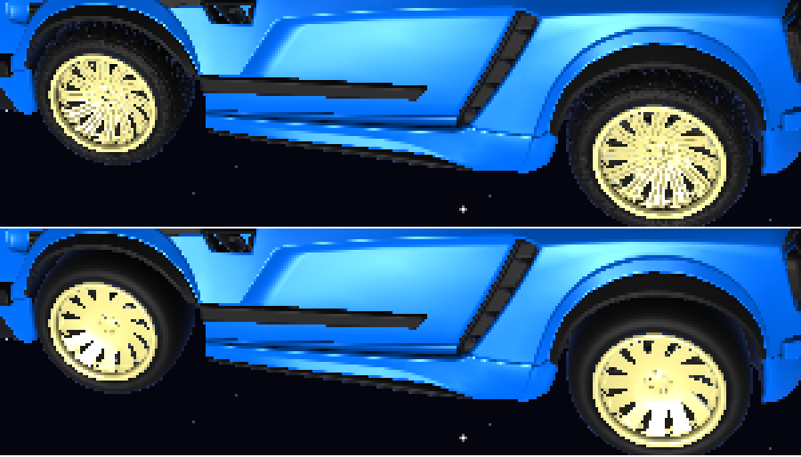

*Arriba con mapa de normales (tecla `M`): dibujo de la llanta y rayos del rin con relieve. Abajo sin él.*

1. **Tangentes:** al cargar el OBJ, para cada triángulo se resuelven la tangente T y la bitangente B
   a partir de sus aristas y de sus diferencias de UV (`e1 = du1·T + dv1·B`, `e2 = du2·T + dv2·B`).
   Se acumulan en los vértices, se hacen perpendiculares a la normal (Gram-Schmidt) y se guarda un
   signo por si las UV están espejadas.
2. **Pipeline:** la UV, el signo y la tangente se interpolan por píxel con corrección de perspectiva.
3. **Shader:** se arma la base `T, B = signo·(N × T), N` y la normal del mapa se pasa al mundo:
   `n = T·x + B·y + N·z`.
4. **Formatos:** las texturas del Fennec vienen de Unreal. Dos están "empaquetadas" (la x de la
   normal en el canal alfa y la z reconstruida como `√(1 − x² − y²)`), y la y usa la convención de
   DirectX, así que se invierte. El lector detecta el formato solo.

### Superficies de los planetas

Las superficies se calculan una sola vez al arrancar, con ruido, y se guardan en cubemaps de
512×512 por cara ([planets.cpp](src/planets.cpp)). Calcular varias octavas de ruido en cada píxel
de cada cuadro sería demasiado lento para un renderizador por software. Los shaders solo leen esas
texturas y hacen la iluminación. Las normales con relieve salen de diferencias finitas de la altura
del terreno.

---

## Características del menú que solicitamos evaluar

| Característica | Pts | Dónde verla | Implementación |
|---|---|---|---|
| Planetas distinguibles (Duna, Glacia, Vergel, Aurelia, Ignis) que orbitan, giran y se pueden ver de cerca | 50 | Desde el inicio se ven cuatro; `--near 1` a `--near 5` | `scene.cpp`, `planets.cpp` |
| 4 tipos de modelo propio en la superficie: roca, árbol alienígena, cristal, baliza | 20 | Acercarse a cada planeta | `props.cpp` (`makeRock`, `makeAlienTree`...) |
| Distribución procedural reproducible con ruido y semilla | 10 | Tecla `N` / `--seed N` (la misma semilla da la misma imagen) | `props.cpp` `scatterProps`, `scene.cpp` `buildProps` |
| Posición y orientación correctas sobre la superficie curva mientras el planeta gira | 5 | Los objetos acompañan el giro (los árboles siguen sobre los continentes) | `props.cpp` `mergeProps`, `scene.cpp` `frameMatrix` |
| Shaders propios con efecto distinto | 24 | Sol, Duna, Glacia, Vergel, Aurelia, anillos, Ignis (también carro y objetos) | `shaders.cpp` |
| Shader animado | 8 | El sol hierve; las nubes de Vergel se mueven | `sunShader`, `vergelShader` |
| Deformación de la geometría de un planeta con ruido | 10 | Silueta de Duna; tecla `G` para comparar | `geometry.cpp` `displaceSphere`, `scene.cpp` `duneShape` |
| Generación procedural de geometría antes de rasterizar | 10 | Todas las esferas son icosaedros subdivididos | `geometry.cpp` `makeIcosphere` |
| Modo de control local para rodear un planeta | 8 | Cuadro verde; `W` da la vuelta sola; `F` | `ship.cpp` (modo superficie) |
| Aceleración, frenado y giro progresivos, iguales en cualquier equipo | 8 | `galaxia.exe --dt-test` | `ship.cpp` (paso fijo de 1/120 s) |
| Atracción gravitatoria que modifica la trayectoria | 10 | Puntos cian; tecla `V` | `ship.cpp` (`gravityVelocity`) |
| Colisión que impide atravesar el planeta | 4 | `↓` sostenido en superficie, o boost contra un planeta | `ship.cpp` `collide` |
| Descarte de objetos fuera de la vista | 7 | Contadores del HUD; tecla `O` | `renderer.cpp` `sphereInFrustum` |
| Mapeo de normales en el renderizador por software | 8 | Ruedas y chasis del carro; tecla `M` y rueda del ratón para acercarse | `texture.cpp`, `obj_loader.cpp` `computeTangents`, `shaders.cpp` `applyNormalMap` |
| Niveles de detalle según la distancia | 8 | Contador de triángulos al acercarse; tecla `L` | `scene.cpp` `chooseLod`, LOD del carro en `main.cpp` |
| Coherencia visual y claridad de la experiencia | hasta 10 | HUD, ayuda, etiquetas de planetas | `hud.cpp`, `font.cpp` |

Además del mapeo de normales en espacio tangente del carro, los planetas usan una normal **por
píxel** leída de un mapa de normales en espacio del objeto (un cubemap generado a partir de la
altura del terreno) que gira con el planeta.

## Pruebas realizadas

- **Compilación** desde cero con las instrucciones de este README, sin warnings.
- **Ejecución** desde la terminal de MSYS2 y desde PowerShell sin MSYS2 en el PATH.
- **Consistencia del movimiento** (`--dt-test`): el mismo vuelo de 6 s termina exactamente en la
  misma posición a 20, 30, 60, 144 y 240 FPS.
- **Rasterizado en paralelo:** imágenes idénticas byte por byte a la versión de un solo hilo.
- **Descarte de objetos:** imágenes idénticas con y sin él, con menos triángulos enviados.
- **Distribución de objetos:** misma semilla, imagen idéntica; otra semilla, posiciones distintas.
- **Vuelos simulados:** acercamiento, vuelta completa alrededor de un planeta, choque con boost
  sin atravesarlo, salida subiendo o con `F`, y desvío por gravedad (con y sin `V`).
- **Rendimiento** (i5-10500H, 12 hilos): entre 7 y 15 ms por cuadro según la vista.

## Limitaciones conocidas

- El modelo del carro no es de autoría propia (ver *Recursos externos*).
- Los objetos de superficie y los anillos de Aurelia no tienen colisión (el carro los puede atravesar).
- Los asteroides no chocan entre sí y las explosiones no dejan cráteres en los planetas.
- No hay sombras proyectadas entre objetos; solo la sombra del planeta sobre sus objetos.
- La gravedad del sol es suave a propósito, para que el carro detenido no se vaya cayendo.
- Solo se probó en Windows 11 con MSYS2 UCRT64. El código no depende de Windows salvo la copia de
  `SDL2.dll`, pero no se probó en otros sistemas.
- La captura con `P` se guarda como PNG sin compresión (~1.5 MB).

## Regenerar el modelo del carro

Solo hace falta si se cambia el FBX. Desde la raíz del repositorio:

```sh
blender -b --factory-startup --python tools/export_car.py
```
